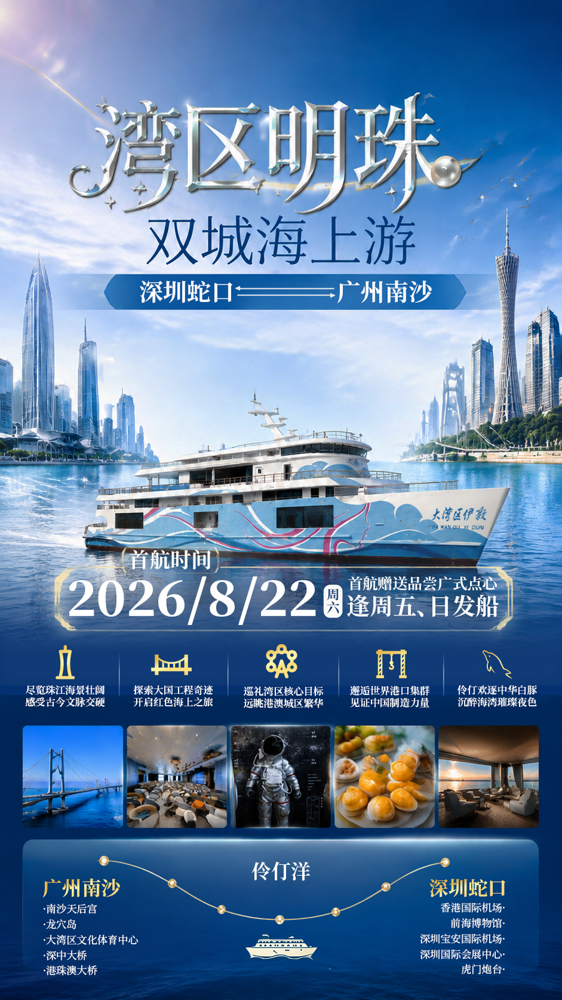

# CharlotMuff — 个人作品集

> 平面视觉设计 · 视频与影像创作 · 三维视觉 · AI 辅助创作探索

个人作品集网站，线上地址：<https://charlotmuff.github.io/portfolio/>

以平面视觉设计为基础，延伸到视频创作、三维表现与 AI 辅助创作的综合型创作者。

技术栈为**纯静态 HTML + CSS + 原生 JavaScript**，不依赖任何框架或构建工具，代码即为线上代码。

---

## 精选作品

站点共展示 7 件作品，按分类筛选：

| 序号 | 作品名称 | 分类 | 原始素材 | 展示副本 |
|---|---|---|---|---|
| 01 | 湾区明珠·双城海上游 | 平面设计 | `assets/img/游轮.png` | `assets/img/optimized/cruise-poster.png` |
| 02 | 匈奴航空·乌兰巴托—深圳 | 平面设计 | `assets/img/乌兰巴托.jpg` | `assets/img/optimized/hunnu-air.jpg` |
| 03 | 太阳富国航空产品推介会 | 平面设计 | `assets/img/邀请函.png` | `assets/img/optimized/sun-airways-invitation.png` |
| 04 | 2018届优秀毕业设计作品展 | 平面设计 | `assets/img/14级毕业展海报.jpg` | `assets/img/optimized/graduation-exhibition-2018.jpg` |
| 05 | 2016级毕业设计作品展 | 平面设计 | `assets/img/16级毕业展海报.jpg` | `assets/img/optimized/graduation-exhibition-2016.jpg` |
| 06 | 短片《返生》 | 视频作品 | `assets/img/特效短片《返生》封面.jpg` | `assets/img/optimized/recovery-cover.jpg` |
| 07 | 茶饮产品广告渲染 | 三维设计 | `assets/img/广告渲染图.jpg` | `assets/img/optimized/milk-tea-3d.jpg` |

分类标识：`all`（全部作品）、`graphic`（平面设计，5 件）、`exhibition`（展会策划与物料设计，暂无作品）、`video`（视频作品，1 件）、`3d`（三维设计，1 件）。

---

## 目录结构

```text
portfolio/
├── index.html          # 页面结构与 SEO 元信息
├── css/
│   └── style.css       # 全部样式、响应式布局与动效
├── js/
│   └── main.js         # 导航、筛选、弹窗、年份等交互
├── assets/
│   ├── favicon.svg     # 站点图标
│   └── img/
│       ├── *.png *.jpg # 原始素材（保持不变，勿删）
│       └── optimized/  # 展示副本（等比缩放，最长边 1600px）
├── .nojekyll           # 关闭 GitHub Pages 的 Jekyll 处理
├── 404.html            # 风格统一的错误页
├── robots.txt          # 爬虫规则
├── .gitignore          # 忽略系统垃圾文件与临时文件
└── README.md
```

## 本地预览

在项目根目录执行任意一种静态服务器：

```bash
# Python（推荐，无需安装额外依赖）
python -m http.server 8000

# 或 Node
npx serve .
```

然后访问 <http://localhost:8000>。

> 请勿直接双击用 `file://` 打开 `index.html`，部分浏览器在本地文件协议下会限制资源加载。

## 更新到 GitHub Pages

本仓库使用 GitHub Pages 的**分支部署**方式（`main` 分支根目录），推送后由 GitHub 自动发布，无需任何构建命令：

```bash
git add .
git commit -m "描述本次改动"
git push
```

通常 1–3 分钟后生效。若仓库改名或迁移，站点地址会随之变化，同时需要更新 `index.html` 中的 `og:url` 与 `404.html` 中的站内链接。

---

## 内容维护

### 图片存放规则

| 目录 | 用途 | 说明 |
|---|---|---|
| `assets/img/` | **原始素材** | 保持原始 PNG/JPG 格式，不覆盖、不重命名、不删除 |
| `assets/img/optimized/` | **展示副本** | 网站实际加载的图片，等比缩放至最长边 1600px |

展示副本由原始素材等比例缩放生成：PNG 仍为 PNG，JPG 仍为 JPG（JPEG 质量 85），不拉伸、不裁剪、不改变画面比例。原始素材始终保留，需要更高分辨率时可直接从 `assets/img/` 取用。

### 替换作品图片

1. 把新图片放入 `assets/img/`，并在 `assets/img/optimized/` 中生成对应展示副本。
2. 在 `index.html` 中找到对应的 `<li class="work-card">`，替换 `.work__media` 内的 ``：

   ```html
   <div class="work__media work__media--poster">
     
   </div>
   ```

3. 同步更新 `.work__title` 与 `.work__cat` 的文字内容。

**注意事项：**

- `src` 必须使用**相对于项目根目录的路径**（如 `assets/img/optimized/xxx.png`），不要写成 `/assets/...`，否则在 `/portfolio/` 子路径部署时会失效。
- `alt` 应描述画面实际内容，便于屏幕阅读器用户获取信息。
- `width` / `height` 应与展示副本的实际像素一致，用于预留布局空间、避免加载时抖动。
- 首屏以外的作品图片保留 `loading="lazy"`。
- 图片一律使用 `object-fit: contain` 完整显示，容器留白由背景色衬托，不会裁切画面。

### 新增作品

1. 在 `index.html` 的 `#work-grid` 中复制一个 `<li class="work-card">`，修改 `data-index`、`data-category`、标题、分类与图片路径。
2. 若新增了分类，还需在 `#work-filters` 中添加带 `data-filter="分类标识"` 的按钮，并在 `js/main.js` 的 `CATEGORY_LABEL` 中补充该分类的中文名称（用于筛选状态提示文案）。

### 调整设计

所有颜色、间距、圆角、字号与布局宽度集中在 `css/style.css` 顶部的 `:root` 变量中，修改一处即可全局生效。

## 无障碍与响应式

- 已适配 1440px / 1280px / 768px / 390px / 375px / 320px 等常见宽度。
- 支持键盘操作：Tab 聚焦、`Enter` / `Space` 激活、`Escape` 关闭弹窗与菜单、方向键在分类按钮间移动。
- 遵循系统「减少动态效果」设置（`prefers-reduced-motion`）。
- 页面语言标记为 `zh-CN`。

## 版权

© CharlotMuff。站内作品图片为本人创作，原始素材保留于 `assets/img/` 目录。
